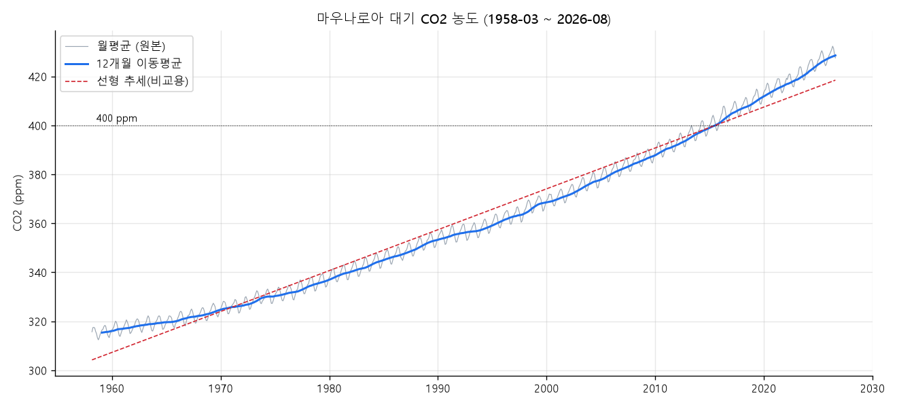
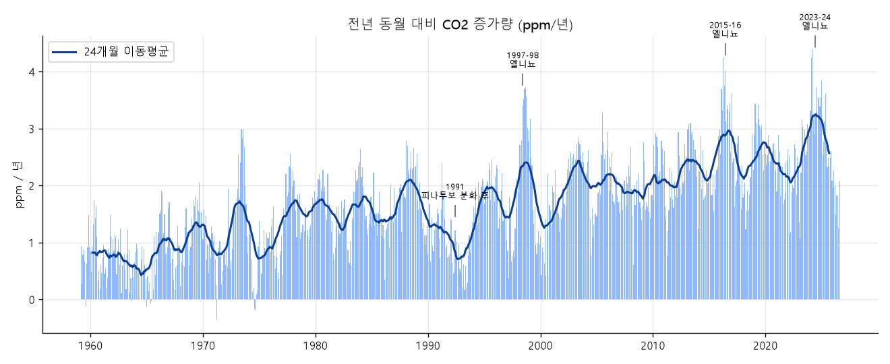
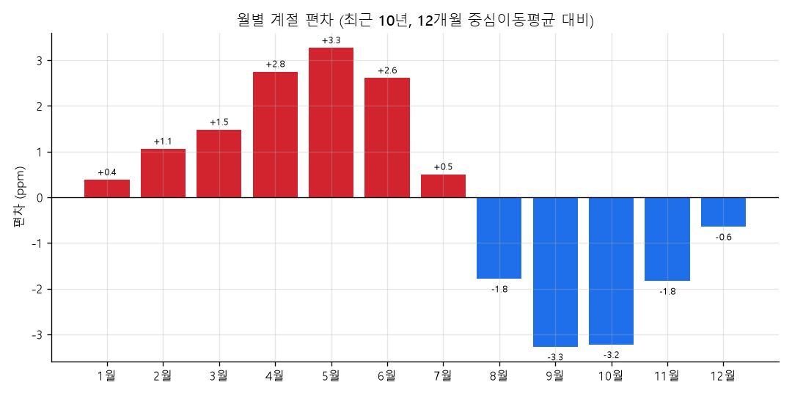
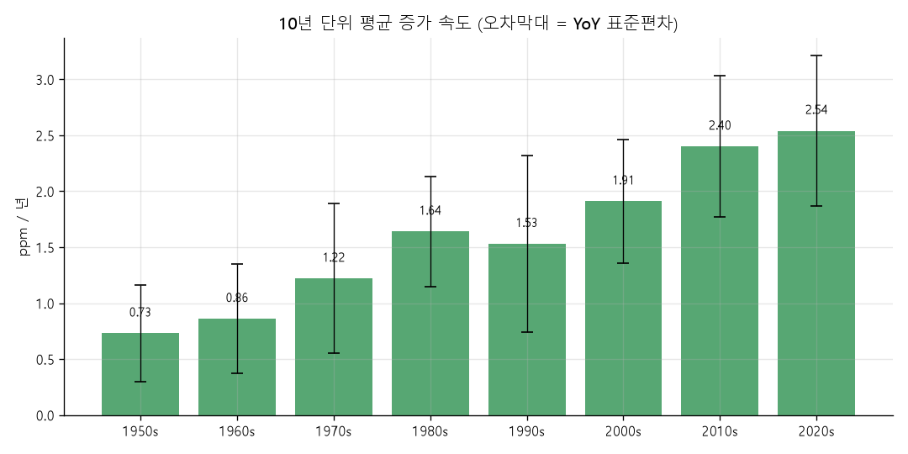
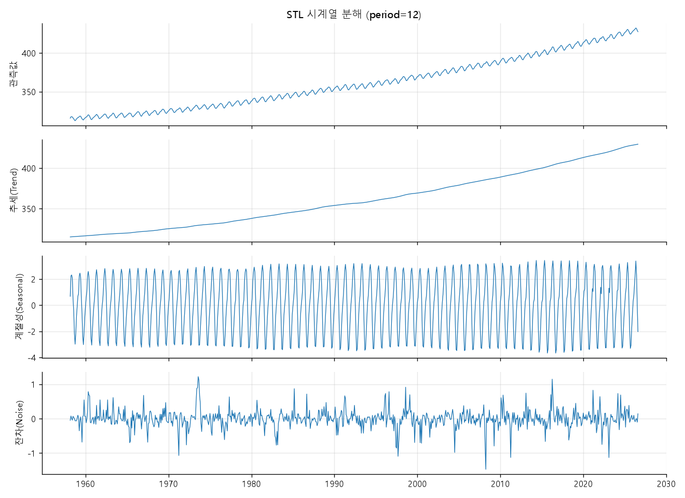
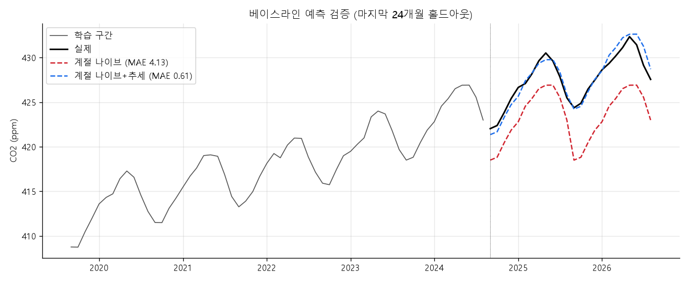

# 대기 CO2 농도 트렌드 분석 리포트 (마우나로아, 1958 ~ 2026)

## 1. 분석 주제 및 선정 이유

- 대기 CO2 농도는 기후 변화 논의의 가장 기본이 되는 지표이고, 1958년부터 거의 끊김 없이 월 단위로 측정되어 왔다.
- 이 데이터에는 **추세(꾸준한 증가)**, **계절성(매년 반복되는 오르내림)**, **노이즈(해마다 다른 증가 속도)**가 모두 뚜렷하게 들어 있어서 시계열의 세 요소를 직접 확인하기에 좋다.
- "그냥 계속 오른다"는 것은 누구나 알고 있으므로, 이 분석은 **"얼마나 빠르게, 일정한 속도로 오르는가"**와 **"증가 속도는 왜 해마다 달라지는가"**에 초점을 둔다.

## 2. 분석 질문

1. CO2 농도는 일정한 속도로 증가하는가, 아니면 증가 속도 자체가 빨라지고 있는가?
2. 전년 대비 증가량이 유난히 크거나 작았던 시기는 언제이며, 어떤 외부 사건과 연결해 볼 수 있는가? (2020년 코로나 봉쇄 효과가 보이는가?)
3. 1년 안에서 농도는 어떤 계절 패턴을 보이며, 그 크기는 장기 추세에 비해 얼마나 중요한가?
4. (보너스) 단순한 규칙만으로 2년 뒤를 얼마나 예측할 수 있는가?

## 3. 데이터 설명

| 항목 | 내용 |
|---|---|
| 원 출처 | NOAA Global Monitoring Laboratory, Mauna Loa Observatory (하와이) |
| 수집 경로 | NOAA 데이터를 CSV로 옮겨 둔 공개 저장소 `datasets/co2-ppm` (`co2-mm-mlo.csv`) |
| 기간 | 1958-03 ~ 2026-08 (월별) |
| 데이터 수 | **822개월** |
| 사용 컬럼 | `date`, `co2`(월평균, ppm), `co2_deseason`(NOAA 계절보정값), `ndays`(측정일수), `sdev`, `unc` |
| 라이선스 | 미국 정부 공개 데이터. NOAA는 출처 표기와 최신 값 확인을 요청함 |

### 데이터 정제 기준

| 점검 항목 | 결과 | 처리 |
|---|---|---|
| 헤더 불일치 | 원본 CSV의 헤더 이름이 실제 열 의미와 맞지 않음 (예: `Interpolated`라는 열에 실제로는 계절보정값이 들어 있음) | NOAA 원본 형식에 맞춰 열 이름을 다시 지정 |
| 누락된 달 | 1958-03 ~ 2026-08 사이 빠진 달 **0개** | 처리 불필요 |
| `co2` 결측 | **0건** | 처리 불필요 |
| 결측 코드 | `ndays = -1`(195건), `sdev = -9.99`(196건), `unc = -0.99`(194건). 모두 1958~1975년에 몰려 있음 | 값이 음수인 측정일수는 불가능하므로 NOAA의 "정보 없음" 코드로 보고 **NaN 처리**. CO2 값 자체는 유지 |
| 이상치 | 계절성을 뺀 잔차의 \|z\| > 3 기준으로 **5건** (1958-09, 1971-04, 1973-08, 2016-04, 2022-02) | 모두 300~450ppm 안이고 앞뒤 흐름에서 튀는 정도가 1ppm 안팎이라 **측정 오류가 아닌 실제 변동으로 보고 유지**. 특히 2016-04는 강한 엘니뇨 시기와 겹침 |

> 이상치를 찾을 때 원본 값에 바로 z-score를 쓰면, 매년 9~10월에 떨어지는 정상적인 계절 저점까지 이상치로 잡힌다. 그래서 12개월 중심 이동평균과 월별 평균 편차를 먼저 빼고 남은 잔차로 판단했다.

## 4. 분석 기법

| 기법 | 목적 |
|---|---|
| 12개월 이동평균 | 계절 오르내림을 지우고 장기 추세만 보기 위해. 주기가 12개월이므로 창도 12개월로 맞춤 |
| 전년 동월 대비 증가량 (YoY, ppm/년) | 같은 달끼리 비교해 계절 효과 없이 **증가 속도**를 보기 위해 |
| 10년 구간별 평균·표준편차 | 증가 속도가 시대별로 달라졌는지 비교 |
| 월별 집계 (최근 10년) | 계절 패턴의 모양과 크기 확인 |
| 선형 / 2차 추세 적합 | "일정한 속도"인지 "가속"인지 수치로 비교 |
| STL 분해 (보너스 A) | 추세·계절성·노이즈를 분리 |
| 베이스라인 예측 (보너스 B) | 단순 규칙의 예측력과 한계 확인 |

**집계 단위 선택 근거:** 원본이 월 단위이고 계절 주기가 1년이므로, 추세는 월 단위 + 12개월 창, 증가 속도는 전년 동월 비교, 장기 비교는 10년 단위로 묶었다. 연 단위로 묶으면 계절 패턴이 사라지고, 일 단위 데이터는 이 출처에 없다.

## 5. 분석 결과 및 시각화

### 그림 1. 전체 추세와 이동평균



- 1958-03의 315.71ppm에서 2026-08의 427.55ppm으로 **111.8ppm(+35.4%) 증가**했다.
- 월평균이 처음 400ppm을 넘은 달은 **2013-05**, 연평균이 처음 400ppm을 넘은 해는 **2015년**이다.
- 빨간 점선(직선 추세)은 1960년대와 2020년대에는 실제 값보다 **아래**, 1980~2000년대에는 **위**에 있다. 직선으로 설명되지 않는 휘어짐이 있다는 뜻이다.
- 스케일 점검: 세로축을 0부터 시작하면 300~430ppm의 변화가 평평하게 보이므로 데이터 범위에 맞췄다.

### 그림 2. 전년 동월 대비 증가량 (증가 속도)



- 증가 속도가 가장 컸던 달: **2024-03 (+4.39ppm)**, 2016-04 (+4.25), 2024-02 (+4.24), 2016-06 (+4.02), 2025-01 (+3.85).
- 1980년 이후 증가 속도가 가장 작았던 달은 **1993년 2~7월 (+0.17 ~ +0.30ppm)** 에 몰려 있다.
- 연평균 증가량: 2019년 2.93 → **2020년 2.56** → 2021년 2.20ppm.

### 그림 3. 월별 계절 패턴 (최근 10년)



- 5월이 가장 높고(**+3.27ppm**), 9월이 가장 낮다(**−3.27ppm**). 10월(−3.22)까지 바닥이 이어진다.
- 4~6월은 크게 높고 8~11월은 크게 낮다. 한 해 안에서 오르내림 폭은 약 **6.5ppm**이다.

### 그림 4. 10년 단위 평균 증가 속도



| 구간 | 평균 농도 (ppm) | 평균 증가량 (ppm/년) | 표준편차 |
|---|---|---|---|
| 1960년대 | 320.3 | 0.86 | 0.49 |
| 1970년대 | 330.9 | 1.22 | 0.67 |
| 1980년대 | 345.7 | 1.64 | 0.49 |
| 1990년대 | 360.6 | 1.53 | 0.79 |
| 2000년대 | 378.8 | 1.91 | 0.55 |
| 2010년대 | 400.4 | 2.40 | 0.63 |
| 2020년대 (~2026-08) | 421.3 | **2.54** | 0.67 |

(1950년대는 1958-03 ~ 1959-12의 22개월뿐이라 비교에서 제외)

### 그림 5. STL 분해 (보너스 A)



- 전체 분산 중 **추세 99.6%, 계절성 0.39%, 잔차 0.006%**.
- 잔차의 표준편차는 **0.27ppm**으로, 계절 진폭(약 6.5ppm)에 비해 매우 작다.

### 그림 6. 베이스라인 예측 (보너스 B)



마지막 24개월(2024-09 ~ 2026-08)을 가려 두고, 그 전 데이터만으로 예측한 뒤 실제와 비교했다.

| 방법 | 규칙 | 평균 절대오차(MAE) |
|---|---|---|
| 계절 나이브 | "작년 같은 달 값이 그대로 나온다" | 4.13 ppm |
| 계절 나이브 + 추세 | "작년 같은 달 값 + 최근 3년 평균 증가량" | **0.61 ppm** |

## 6. 인사이트

### 인사이트 1. CO2는 그냥 오르는 것이 아니라 "점점 더 빨리" 오르고 있다

- **관찰(Fact):** 10년 평균 증가 속도가 1960년대 0.86ppm/년에서 2020년대 2.54ppm/년으로 **약 3배**가 되었다 (그림 4). 직선 추세의 오차(RMSE)는 5.24ppm, 2차 곡선은 2.24ppm으로 곡선이 훨씬 잘 맞는다. 그림 1에서도 직선이 양 끝에서 실제 값보다 아래에 있다.
- **해석(가설):** 화석연료 배출량 자체가 수십 년간 늘어 왔기 때문으로 보인다. 다만 1990년대(1.53)는 1980년대(1.64)보다 오히려 낮아, 가속이 매끄럽지는 않다. 이 시기는 소련 해체에 따른 동구권 배출 감소, 피나투보 화산 분화가 겹친 때라 배출 외 요인도 작용했을 수 있다.
- **행동(Action):** "연간 약 1.7ppm씩 증가" 같은 전체 기간 직선 기울기(1.67ppm/년)는 최근 상황을 과소평가한다. 현재 수준을 말할 때는 최근 10년 증가 속도(약 2.4~2.5ppm/년)를 써야 한다. 다음 분석으로 연도별 배출량 데이터를 붙여 증가 속도와의 상관을 확인할 수 있다.

### 인사이트 2. 해마다의 증가 속도 차이는 배출보다 "자연(엘니뇨·화산)"이 더 크게 좌우한다

- **관찰(Fact):** 증가 속도 상위 5개 달이 모두 2016년과 2024~2025년 초에 몰려 있고, 1998년 연평균 증가량(2.96)도 앞뒤 해보다 높다 (그림 2). 세 시기 모두 강한 엘니뇨가 있었던 때다. 반대로 1980년 이후 최저 증가 속도는 1993년(+0.17ppm)에 나타났는데, 1991년 피나투보 화산 분화 직후다.
- **관찰(Fact):** 코로나 봉쇄가 있었던 2020년의 증가량(2.56)은 2019년(2.93)보다 낮지만, 2021년(2.20)은 더 낮다. 즉 2020년만 유독 꺾인 모습은 보이지 않는다.
- **해석(가설):** 엘니뇨 때는 열대 지역의 가뭄·산불로 육지 생태계가 CO2를 덜 흡수해 증가 속도가 빨라지고, 화산 분화 뒤에는 기온이 일시적으로 낮아지고 산란광이 늘어 식물 흡수가 늘었을 가능성이 있다. 2020년 배출 감소는 실제로 있었겠지만, 1년 치 감소분이 이런 자연 변동(연간 ±1ppm 수준)보다 작아 데이터에서 구별되지 않는 것으로 보인다. 단, 이 데이터만으로는 원인을 확정할 수 없다. 엘니뇨 지수(ONI) 같은 외부 데이터를 붙여 비교해야 한다.
- **행동(Action):** 한 해의 증가량이 크거나 작다고 해서 "배출이 늘었다/줄었다"고 결론 내리면 안 된다. 배출 정책의 효과는 최소 수년 단위의 평균으로 봐야 한다.

### 인사이트 3. 계절 변동은 눈에 띄지만, 장기 추세에 비하면 작다

- **관찰(Fact):** 매년 5월에 최고(+3.27ppm), 9월에 최저(−3.27ppm)로 한 해 약 6.5ppm 오르내린다 (그림 3). 그러나 STL 분해에서 계절성이 전체 분산에서 차지하는 비중은 0.39%뿐이고 추세가 99.6%다 (그림 5).
- **해석(가설):** 마우나로아는 북반구에 있고, 북반구 육지 식물이 봄~여름에 광합성으로 CO2를 흡수했다가 가을~겨울에 낙엽이 분해되며 다시 내보내는 흐름이 그대로 보이는 것으로 해석된다. 그래서 식물 성장이 왕성한 여름이 지난 9~10월이 바닥이다.
- **행동(Action):** 이 데이터로 "지난달보다 줄었다"는 말을 하면 거의 항상 계절 효과를 보는 것이다. 비교는 반드시 **전년 같은 달**끼리 하거나 계절보정값으로 해야 한다.

### 인사이트 4. (보너스) 추세만 반영해도 2년 예측 오차가 0.6ppm 수준이다

- **관찰(Fact):** 작년 값을 그대로 쓰는 계절 나이브 예측은 MAE 4.13ppm이었지만, 최근 3년 평균 증가량을 더하자 0.61ppm으로 줄었다 (그림 6).
- **해석(가설):** 이 시계열은 추세와 계절성이 매우 규칙적이라 단순 규칙으로도 잘 맞는다. 남은 오차의 상당 부분은 엘니뇨 같은 해마다의 변동(인사이트 2)에서 온다.
- **한계:** "최근 3년의 증가 속도가 계속된다"는 가정에 기대므로, 가속(인사이트 1)이 이어지면 장기로 갈수록 과소예측하고 큰 엘니뇨가 오면 오차가 커진다. 2년보다 긴 예측에 쓰기는 어렵다.

## 7. 결론 및 한계점

### 결론

- 대기 CO2는 68년간 35% 증가했고, **증가 속도 자체가 약 3배로 빨라졌다.**
- 해마다 증가 속도가 들쭉날쭉한 것은 주로 엘니뇨·화산 같은 자연 변동과 시기가 겹치며, 2020년 봉쇄 효과는 그 변동에 묻혀 구별되지 않는다.
- 계절 변동(약 6.5ppm)은 뚜렷하지만 장기 추세에 비하면 작으므로, 비교는 전년 동월 기준으로 해야 한다.

### 한계점

- **단일 관측소:** 마우나로아 한 지점의 값이다. 남반구는 계절 패턴이 반대이고 진폭도 작아, 이 계절 패턴을 "지구 전체"로 일반화할 수 없다.
- **외부 변수 미반영:** 엘니뇨·화산·배출량과의 연결은 시기가 겹친다는 관찰에 근거한 가설이며, 외부 데이터로 검증하지 않았다.
- **초기 측정 품질 정보 부족:** 1958~1975년은 측정일수·표준편차 정보가 없어 그 시기 값의 신뢰도를 비교할 수 없다.
- **최근 값 보정 가능성:** NOAA는 최근 몇 달 값을 사후 보정할 수 있어, 리포트의 최신 수치는 바뀔 수 있다.
- **상관은 인과가 아님:** 이 분석은 패턴을 보여줄 뿐, 원인을 증명하지 않는다.

## 8. 재현 방법

```bash
pip install -r requirements.txt
python analysis.py
```

리포트의 모든 수치는 `results/summary.json`에서 확인할 수 있다. 자세한 내용은 [README.md](README.md) 참고.

## 9. AI 사용 로그

| 사용 작업 | 사용 이유 | 검증 방법 |
|---|---|---|
| 데이터 후보 탐색 및 선택 (CO2 데이터 추천) | 대안 탐색: 추세·계절성·노이즈가 모두 있는 100개 이상 데이터를 빠르게 찾기 위해 | 다운로드한 원본을 직접 열어 행 수(822), 기간, 결측을 확인함 |
| 원본 CSV 열 의미 파악 | 헤더 이름과 실제 값이 맞지 않아 검증이 필요했음 | 첫 행 값(315.71, 314.44, -1, -9.99, -0.99)을 NOAA 원본 파일 형식과 대조해 열 의미를 확정 |
| 분석 코드 작성 (이동평균, YoY, STL, 예측) | 시간 절감 | 1) 첫 달/마지막 달 값을 원본 CSV와 직접 대조 2) 2020년 YoY 평균을 원본 값으로 손계산해 일치 확인 3) 스크립트를 처음부터 다시 실행해 같은 결과가 나오는지 재현 확인 |
| 이상치 기준 설계 | 원본에 z-score를 바로 쓰면 계절 저점이 이상치로 잡히는 문제를 피하기 위해 | 원본 z-score와 잔차 z-score 결과를 비교해, 잔차 기준이 계절 저점을 잡지 않는지 확인 |
| 인사이트 해석 초안 (엘니뇨·화산 연결) | 가능한 원인 가설 목록을 넓히기 위해 | 그래프에서 해당 연도 값을 직접 확인하고, 데이터로 확인된 것(관찰)과 확인되지 않은 것(가설)을 나눠 적음. 최종 판단은 본인이 함 |
| 문장 다듬기 | 가독성 | 수치를 `summary.json`과 하나씩 대조 |
